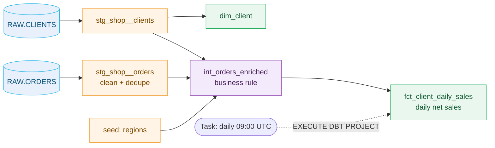

# dbt Projects on Snowflake: Daily Sales Demo


A small, SQL-only dbt project that runs entirely in Snowflake. It turns a messy raw order extract into clean daily net sales per client, tests the result, and schedules it with a task. A tasks-only version of the same pipeline is included for comparison.

All data is synthetic. No packages, external access, or credentials are required.

**Contents:** [How it works](#how-it-works) · [dbt vs. tasks only](#dbt-vs-tasks-only) · [Quick start](#quick-start) · [Demo steps](#demo-steps) · [Optional extras](#optional-extras) · [Reset](#reset) · [Notes](#notes)

## How it works



Each layer has one job and changes the data in a visible way:

| Layer | Model | What it does | Result |
| --- | --- | --- | --- |
| Raw | `RAW.ORDERS` | Source extract, as received | 9 rows: one order loaded twice, mixed casing, a cancelled order, a refund |
| Staging | `stg_shop__orders` | Trim, normalize case, keep the latest load per order | 8 clean rows |
| Intermediate | `int_orders_enriched` | Business rule: completed orders count, cancelled don't, refunds subtract; add region | One definition of "a sale", reused by every mart |
| Mart | `fct_client_daily_sales` | One row per client and day | CLIENT_B, 2026-10-02: gross 60.00, refund 10.00, **net 50.00** |

**Tests** run with every build. The raw duplicate is reported as a warning; the same check on staging must pass, proving it was cleaned. `tests/expected_daily_sales.sql` checks the mart's exact numbers, so a wrong business rule fails the build.

| Target | Staging | Marts |
| --- | --- | --- |
| `dev` | `DEV_STAGING` | `DEV_MARTS` |
| `prod` | `STAGING` | `MARTS` |

One codebase, two environments: `macros/generate_schema_name.sql` keeps dev builds out of prod.

## dbt vs. tasks only

`setup/tasks_only_example.sql` builds the same result with chained tasks and no dbt. Both produce identical output; the difference is what you maintain.

| | Tasks / procedures | dbt project |
| --- | --- | --- |
| Build a table | Hand-written `CREATE OR REPLACE TABLE ... AS` | A `select` statement |
| Run order | Wired by hand with `AFTER` | Inferred from `ref()` |
| Data checks | Procedural code | Tests declared in YAML |
| Dev and prod | Copy the SQL | `--target dev` / `--target prod` |
| Lineage | None | DAG in the workspace |

They work together: **dbt defines what to build; a task decides when.**

## Quick start

**Prerequisites:** a Snowflake lab account, a role that can create a database and tasks (the sample uses `ACCOUNTADMIN`), a warehouse named `COMPUTE_WH`, and the Snowflake CLI or Snowsight.

### Option A: Snowsight workspace

1. Create a GitHub API integration (one time, admin):

   ```sql
   CREATE API INTEGRATION DBT_DEMO_GITHUB_APP
     API_PROVIDER = git_https_api
     API_ALLOWED_PREFIXES = ('https://github.com/<owner>/synthetic-dbt-daily-sales-demo')
     API_USER_AUTHENTICATION = (TYPE = SNOWFLAKE_GITHUB_APP)
     ENABLED = TRUE;
   ```

2. In **Projects » Workspaces » From Git repository**, enter the repository URL, select the integration, and sign in with GitHub. To commit from a workspace, use your own private copy of the repository.
3. Run `setup/synthetic_orders.sql`, then `setup/synthetic_clients.sql`.
4. Select profile `dev`, then **Compile** (DAG and compiled SQL) and **Build**.
5. **Connect » Deploy dbt project** to schema `PROD` as `SYNTHETIC_DBT_PROJECT`.

### Option B: Snowflake CLI

```sh
snow sql -c default -f setup/synthetic_orders.sql
snow sql -c default -f setup/synthetic_clients.sql
snow dbt deploy SYNTHETIC_DBT_PROJECT --source . \
  --database SYNTHETIC_DBT_DAILY_SALES_DEMO --schema PROD -c default

demo_dbt() { snow dbt execute -c default --database SYNTHETIC_DBT_DAILY_SALES_DEMO --schema PROD SYNTHETIC_DBT_PROJECT "$@"; }
demo_dbt build --target dev
```

Expected: `PASS=34 WARN=1 ERROR=0` (the warning is the raw duplicate), and this mart:

| Client | Region | Date | Orders | Gross | Refunds | Net |
| --- | --- | --- | ---: | ---: | ---: | ---: |
| CLIENT_A | West | 2026-10-01 | 2 | 30.00 | 0.00 | 30.00 |
| CLIENT_A | West | 2026-10-02 | 1 | 7.00 | 0.00 | 7.00 |
| CLIENT_A | West | 2026-10-03 | 1 | 99.00 | 0.00 | 99.00 |
| CLIENT_B | East | 2026-10-01 | 1 | 40.00 | 0.00 | 40.00 |
| CLIENT_B | East | 2026-10-02 | 1 | 60.00 | 10.00 | 50.00 |

## Demo steps

A 30-minute walkthrough:

| Time | Step | Show |
| --- | --- | --- |
| 0–5 | The problem | Query `RAW.ORDERS`: the duplicate, casing, cancelled order, refund |
| 5–12 | The models | Staging → intermediate → mart; **Compile**, DAG, compiled SQL |
| 12–18 | Build and test | **Build** on dev; then a failing test (below) |
| 18–24 | Deploy and schedule | Deploy to prod; create the task (below) |
| 24–30 | dbt vs. tasks only | `setup/tasks_only_example.sql` next to the models |

**A test that fails, then passes.** Disabled by default so scheduled builds stay green:

```sh
demo_dbt test --select demo_order_amount_cap --target dev --vars '{show_failing_test: true}'
# Fails: orders A4 (99.00) and B2 (60.00) exceed the cap of 50
demo_dbt test --select demo_order_amount_cap --target dev --vars '{show_failing_test: true, max_order_amount: 1000}'
# Passes
```

**Deploy and schedule:**

```sh
demo_dbt build --target prod
snow sql -c default -f setup/schedule_tasks.sql   # creates DBT_DAILY_BUILD, suspended
```

Run it once without enabling the schedule:

```sql
EXECUTE TASK SYNTHETIC_DBT_DAILY_SALES_DEMO.PROD.DBT_DAILY_BUILD;
```

**Tasks-only comparison:**

```sh
snow sql -c default -f setup/tasks_only_example.sql   # builds into schema TASKS_ONLY
```

See the file header for how to run the task graph once. Its output matches `MARTS.FCT_CLIENT_DAILY_SALES` row for row.

## Optional extras

| Topic | How |
| --- | --- |
| **Rerun one client and date** (incremental, delete+insert) | `snow sql -c default -f setup/new_orders.sql`, then `demo_dbt run --select fct_client_daily_sales_incremental --target dev --vars '{client_id: CLIENT_B, start_date: 2026-10-04, end_date: 2026-10-04}'` |
| **History of a changing attribute** (snapshot) | `snow sql -c default -f setup/client_tier_change.sql`, then `demo_dbt snapshot --target dev`; query `DEV_HISTORY.HIST_CLIENTS` |
| **Dynamic table** | `fct_client_daily_sales_dt` refreshes on its `target_lag` (1 day) rather than when dbt runs |
| **Second scheduled step** | `setup/schedule_tasks.sql` also creates `DBT_SLICE_RERUN`, which runs after the daily build |

## Reset

The optional extras change the source data. To start over:

```sql
DROP DATABASE IF EXISTS SYNTHETIC_DBT_DAILY_SALES_DEMO;
```

Then rerun the quick start. This also removes the project object and tasks.

## Notes

- Tested end to end on November 10, 2026, on dbt 1.9.4, including a row-for-row match between the dbt mart and the tasks-only output.
- The sample uses `ACCOUNTADMIN` and `COMPUTE_WH` for lab convenience. Use a least-privilege role outside a lab.
- Tasks that run a dbt project must be in the same schema as the project object and use a user-managed warehouse.
- `--vars` values are inserted into SQL text; use them only for trusted operator inputs.
- This is a learning sample, not a supported Snowflake product.

**Owner:** Dureti Shemsi ([dureti.shemsi@snowflake.com](mailto:dureti.shemsi@snowflake.com), [@sfc-gh-dshemsi](https://github.com/sfc-gh-dshemsi)). Licensed under [Apache-2.0](LICENSE).

**References:** [dbt Projects on Snowflake](https://docs.snowflake.com/en/user-guide/data-engineering/dbt-projects-on-snowflake) · [Getting-started tutorial](https://docs.snowflake.com/en/user-guide/tutorials/dbt-projects-on-snowflake-getting-started-tutorial) · [Schedule dbt project runs](https://docs.snowflake.com/en/user-guide/data-engineering/dbt-projects-on-snowflake-schedule-project-execution) · [Dynamic tables in dbt](https://docs.snowflake.com/en/user-guide/dynamic-tables/dbt)
