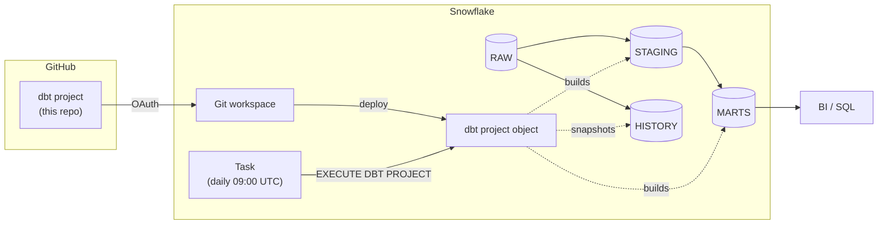
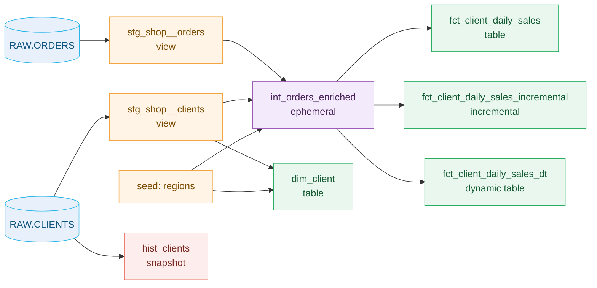
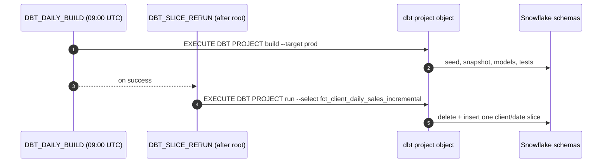

# dbt Projects on Snowflake: Synthetic Daily Sales Demo


A small, self-contained dbt project that runs entirely inside Snowflake. It takes a deliberately messy raw order extract (a re-loaded duplicate, inconsistent casing, a cancelled order, a refund), cleans it, applies one business rule, and produces daily net sales per client. Along the way it shows the parts of dbt most teams need: layered models, tests, incremental reruns, snapshots, a dynamic table, dev and prod environments, and a scheduled task. A tasks-only version of the same pipeline is included for comparison.

All data is synthetic. No external dbt packages, external access integration, or credentials are needed.

**Contents:** [Architecture](#architecture) · [The transformation](#the-transformation) · [What you'll learn](#what-youll-learn) · [Repository structure](#repository-structure) · [Prerequisites](#prerequisites) · [Install](#install) · [Scenarios](#scenarios) · [Suggested walkthrough](#suggested-walkthrough) · [Reset the lab](#reset-the-lab) · [Verification](#verification) · [Notes](#notes)

## Architecture



| Component | Role |
| --- | --- |
| GitHub repository | Source of truth for models, tests, and configuration. |
| Git workspace | Browser IDE in Snowsight. Edit, compile, view the DAG, build, and deploy. |
| dbt project object | The deployed copy of the project that Snowflake runs. |
| Task | Schedules the project object. dbt defines **what** runs; the task decides **when**. |
| `RAW` | Synthetic source tables, created by the `setup/` scripts. |
| `STAGING`, `MARTS`, `HISTORY` | Layer schemas dbt builds into (prefixed `DEV_` for the dev target). |

### Model lineage



`fct_client_daily_sales` is the main model. The `_incremental` and `_dt` versions compute the same result with other materializations; they're optional extras for comparison. In a real project you'd choose one.

### Layers and environments

| Layer | Folder | Prefix | Materialization | `--target dev` | `--target prod` |
| --- | --- | --- | --- | --- | --- |
| Staging | `models/staging/shop/` | `stg_` | view | `DEV_STAGING` | `STAGING` |
| Intermediate | `models/intermediate/` | `int_` | ephemeral (inlined, not built) | — | — |
| Marts | `models/marts/sales/` | `fct_`, `dim_` | table | `DEV_MARTS` | `MARTS` |
| Snapshots | `snapshots/` | `hist_` | snapshot | `DEV_HISTORY` | `HISTORY` |
| Seeds | `seeds/` | — | table | `DEV_STAGING` | `STAGING` |

`macros/generate_schema_name.sql` routes each layer to its schema per target, so dev never writes into prod. This project uses one database; a project with separate databases per environment adds a `generate_database_name` macro the same way.

## The transformation

Each layer has one job, and each changes something you can see in the data.

| Layer | Model | Job | What changes in this data |
| --- | --- | --- | --- |
| Source | `RAW.ORDERS` | Raw extract, as received | 9 rows. A2 is loaded twice, as `' client_a '` / `'Completed'`. A5 is `CANCELLED`. R1 is a 10.00 `REFUNDED` row. |
| Staging | `stg_shop__orders` | Clean: trim, uppercase ids, lowercase status, keep the latest load per `order_id` | 8 rows. Duplicate A2 removed; `CLIENT_A`, `completed` everywhere. |
| Intermediate | `int_orders_enriched` | Business rule, defined once: completed orders count, cancelled don't, refunds subtract; add the client's region | A5 dropped; R1 becomes a refund amount; region attached. |
| Mart | `fct_client_daily_sales` | Aggregate to one row per client and day | CLIENT_B on 2026-10-02: gross 60.00, refund 10.00, **net 50.00**. |

The tests follow the same story. The `unique` test on the raw `order_id` is set to **warn**: the build reports the known duplicate (`WARN=1`) without failing. The same test on `stg_shop__orders` is strict, which proves staging fixed it. `tests/expected_daily_sales.sql` checks the mart's exact numbers, so a wrong rule (counting the cancelled order, double-counting A2, or ignoring the refund) fails the build.

### dbt vs. tasks only

`setup/tasks_only_example.sql` builds the same pipeline with chained tasks and no dbt, in its own `TASKS_ONLY` schema. Both produce identical results. The difference is what you maintain:

| Concern | Tasks only | dbt project |
| --- | --- | --- |
| Build each table | Hand-written `CREATE OR REPLACE TABLE ... AS` | `select` + `materialized` config |
| Run order | Wired by hand with `AFTER` | Inferred from `ref()` |
| Data checks | Procedural code that raises an error | Tests declared in YAML, reported per run |
| Dev and prod | A second copy of the SQL, or string swapping | `--target dev` / `--target prod` |
| Rerun one slice | Custom procedure | `--vars` on an incremental model |
| History of a changing attribute | Custom merge logic | `snapshot` |
| Lineage and docs | None built in | DAG and compiled SQL in the workspace |

Tasks are still used with dbt: a task schedules `EXECUTE DBT PROJECT` (scenario 5). dbt defines **what** to build; the task decides **when**.

## What you'll learn

| Concept | Where to look |
| --- | --- |
| Cleaning and deduplicating raw data in staging | `models/staging/shop/stg_shop__orders.sql` |
| A business rule defined once and reused | `models/intermediate/int_orders_enriched.sql` |
| Sources, `source()`, `ref()`, and the DAG | `models/staging/shop/` → `models/intermediate/` → `models/marts/sales/` |
| Staging, intermediate, and mart layers | `models/` |
| Materializations: view, ephemeral, table, incremental, dynamic table | `dbt_project.yml`, model `config()` blocks |
| Rerun one client and date with delete+insert and `--vars` | `fct_client_daily_sales_incremental.sql` |
| Snapshot (SCD Type 2) history of a changing attribute | `snapshots/hist_clients.sql` |
| Seed: reference data from CSV | `seeds/regions.csv` |
| Macro: per-environment schema names | `macros/generate_schema_name.sql` |
| Tests: built-in, relationships, accepted values, warn severity, custom generic, exact result | `_shop__models.yml`, `_sales__models.yml`, `tests/` |
| A planned failing test to fix live | `tests/demo_order_amount_cap.sql` |
| Dev and prod targets from one codebase | `dbt_projects_profiles.yml` |
| Scheduling with tasks | `setup/schedule_tasks.sql` |
| The same pipeline without dbt | `setup/tasks_only_example.sql` |

## Repository structure

```text
.
├── dbt_project.yml               Project config: layers, schemas, vars
├── dbt_projects_profiles.yml     dev and prod targets for dbt Projects on Snowflake
├── models/
│   ├── staging/shop/             stg_  cleaned views, one per source table
│   ├── intermediate/             int_  business rule (ephemeral)
│   └── marts/sales/              fct_ / dim_  business-ready tables
├── snapshots/                    hist_ SCD Type 2 history
├── seeds/                        Static reference data
├── macros/                       generate_schema_name (environment routing)
├── tests/
│   ├── generic/                  Custom generic tests
│   └── *.sql                     Singular tests
└── setup/                        Source data, demo changes, task SQL, tasks-only comparison
```

## Prerequisites

| Requirement | Used for |
| --- | --- |
| A Snowflake **lab** account (not production) | Everything. The setup scripts create a database. |
| A role that can create a database, schemas, tables, a dbt project object, and tasks | The sample profile uses `ACCOUNTADMIN` for simplicity; use a narrower role outside a lab. |
| A warehouse named `COMPUTE_WH` | Builds and task runs. |
| Snowflake CLI with a connection (examples use `-c default`) | CLI install. Confirm the connection points to your lab. |
| GitHub account | Git workspace install. |

To use different object names, change them consistently in `dbt_projects_profiles.yml`, `models/staging/shop/_shop__sources.yml`, `models/marts/sales/fct_client_daily_sales_dt.sql`, and the `setup/` scripts.

## Install

### Option A: Git workspace in Snowsight

1. **Create an API integration (one time, admin).** It uses the Snowflake GitHub App for OAuth. Scope the prefix to your copy of the repository:

   ```sql
   CREATE API INTEGRATION DBT_DEMO_GITHUB_APP
     API_PROVIDER = git_https_api
     API_ALLOWED_PREFIXES = ('https://github.com/<owner>/synthetic-dbt-daily-sales-demo')
     API_USER_AUTHENTICATION = (TYPE = SNOWFLAKE_GITHUB_APP)
     ENABLED = TRUE;
   ```

2. **Create the workspace.** In Snowsight, go to **Projects » Workspaces » From Git repository**. Enter the repository URL, select `DBT_DEMO_GITHUB_APP`, choose OAuth, and sign in with GitHub.

   > Workspaces can't commit and push to a public repository. To commit from a workspace, copy this repository into a private repository of your own and connect the workspace to that.

3. **Create the source data.** Run `setup/synthetic_orders.sql`, then `setup/synthetic_clients.sql`, once.
4. **Build.** From the dbt toolbar, choose profile `dev`, run **Compile** to view the DAG and compiled SQL, then **Build**. `build` also loads the seed, runs the snapshot, and runs every test.
5. **Deploy.** Use **Connect » Deploy dbt project** to deploy to schema `PROD` as `SYNTHETIC_DBT_PROJECT`.

### Option B: Snowflake CLI

```sh
# Confirm you're pointed at the lab
snow sql -c default -q 'select current_account_name(), current_role(), current_warehouse()'

# One-time source data
snow sql -c default -f setup/synthetic_orders.sql
snow sql -c default -f setup/synthetic_clients.sql

# Deploy and build
snow dbt deploy SYNTHETIC_DBT_PROJECT --source . \
  --database SYNTHETIC_DBT_DAILY_SALES_DEMO --schema PROD -c default
snow dbt execute -c default --database SYNTHETIC_DBT_DAILY_SALES_DEMO --schema PROD \
  SYNTHETIC_DBT_PROJECT build --target dev
```

The build ends with `PASS=34 WARN=1 ERROR=0`. The warning is the raw duplicate, by design.

Expected `DEV_MARTS.FCT_CLIENT_DAILY_SALES` after the first build:

| Client | Region | Order date | Orders | Gross | Refunds | Net |
| --- | --- | --- | ---: | ---: | ---: | ---: |
| CLIENT_A | West | 2026-10-01 | 2 | 30.00 | 0.00 | 30.00 |
| CLIENT_A | West | 2026-10-02 | 1 | 7.00 | 0.00 | 7.00 |
| CLIENT_A | West | 2026-10-03 | 1 | 99.00 | 0.00 | 99.00 |
| CLIENT_B | East | 2026-10-01 | 1 | 40.00 | 0.00 | 40.00 |
| CLIENT_B | East | 2026-10-02 | 1 | 60.00 | 10.00 | 50.00 |

## Scenarios

The CLI commands share a long prefix. Define this shell function once (works in bash and zsh):

```sh
demo_dbt() { snow dbt execute -c default --database SYNTHETIC_DBT_DAILY_SALES_DEMO --schema PROD SYNTHETIC_DBT_PROJECT "$@"; }
```

### 1. A test that fails, then passes

`tests/demo_order_amount_cap.sql` is disabled by default so scheduled builds stay green.

```sh
demo_dbt test --select demo_order_amount_cap --target dev --vars '{show_failing_test: true}'
# Fails: orders A4 (99.00) and B2 (60.00) exceed the cap of 50

demo_dbt test --select demo_order_amount_cap --target dev --vars '{show_failing_test: true, max_order_amount: 1000}'
# Passes
```

In a workspace, you can instead raise `max_order_amount` in `dbt_project.yml` and rerun.

### 2. Rerun one client and date (incremental)

```sh
snow sql -c default -f setup/new_orders.sql      # adds order B3: CLIENT_B, 2026-10-04
demo_dbt run --select fct_client_daily_sales_incremental --target dev \
  --vars '{client_id: CLIENT_B, start_date: 2026-10-04, end_date: 2026-10-04}'
```

dbt deletes only the `client_day_key` values in the slice, then inserts the recomputed rows. Only the incremental model changes; `fct_client_daily_sales` catches up on the next `build`, and the dynamic table on its next refresh. A key that disappears from the source inside the slice is not deleted, so decide how a real job should handle that.

> Running `setup/new_orders.sql` twice inserts B3 a second time. Staging keeps one copy, so results don't change, but the raw `unique` warning count rises to 2. [Reset the lab](#reset-the-lab) for a clean start.

### 3. Keep history with a snapshot

```sh
snow sql -c default -f setup/client_tier_change.sql   # CLIENT_B: standard -> gold
demo_dbt snapshot --target dev
snow sql -c default -q "select client_id, tier, dbt_valid_from, dbt_valid_to
  from SYNTHETIC_DBT_DAILY_SALES_DEMO.DEV_HISTORY.HIST_CLIENTS order by client_id, dbt_valid_from"
```

| Client | Tier | Valid from | Valid to |
| --- | --- | --- | --- |
| CLIENT_A | standard | 2026-09-01 | — |
| CLIENT_B | standard | 2026-09-01 | 2026-10-15 |
| CLIENT_B | gold | 2026-10-15 | — |

`dim_client` shows only the current tier after its next build; the snapshot keeps the history.

### 4. Dynamic table vs. dbt-run table (optional)

`fct_client_daily_sales_dt` is refreshed by Snowflake on its `target_lag` (1 day), not when dbt runs, so right after scenario 2 it still shows the earlier rows. Snowflake's documentation lists dbt-snowflake adapter v1.11.5 or later for omitting `target_lag` so that dbt triggers the refresh instead ([Use dynamic tables in dbt](https://docs.snowflake.com/en/user-guide/dynamic-tables/dbt)). This project runs on dbt 1.9.4, so it sets `target_lag`.

### 5. Build prod and schedule it

```sh
demo_dbt build --target prod
snow sql -c default -f setup/schedule_tasks.sql
```



Both tasks are created **suspended**. Tasks must be in the same database and schema as the dbt project object and use a user-managed warehouse. To run the graph once without enabling the schedule:

```sql
ALTER TASK SYNTHETIC_DBT_DAILY_SALES_DEMO.PROD.DBT_SLICE_RERUN RESUME;
EXECUTE TASK SYNTHETIC_DBT_DAILY_SALES_DEMO.PROD.DBT_DAILY_BUILD;
-- after it finishes
ALTER TASK SYNTHETIC_DBT_DAILY_SALES_DEMO.PROD.DBT_SLICE_RERUN SUSPEND;
```

## Suggested walkthrough

A 30-minute order that follows one path, messy raw data to a scheduled mart:

| Time | Segment | Show |
| --- | --- | --- |
| 0–4 | The problem | Query `RAW.ORDERS`: the duplicate, the casing, the cancelled order, the refund |
| 4–10 | Clean, then apply the rule | `stg_shop__orders` → `int_orders_enriched` → `fct_client_daily_sales`; **Compile**, DAG tab, compiled SQL |
| 10–16 | Build and tests | **Build** on dev; the raw duplicate warns, staging's test passes; then scenario 1 |
| 16–20 | Incremental rerun | Scenario 2, mapped to a delete / recompute / insert procedure |
| 20–26 | Environments and scheduling | `dbt_projects_profiles.yml`, the schema macro, scenario 5 |
| 26–30 | dbt vs. tasks only | `setup/tasks_only_example.sql` next to the dbt models |

Keep the snapshot (scenario 3) and the dynamic table (scenario 4) for questions.

Before presenting, [reset the lab](#reset-the-lab) if earlier rehearsals changed the source data.

## Reset the lab

Scenarios 2 and 3 change the source data. To start over, drop the demo database and reinstall. This also removes the dbt project object and tasks.

```sql
DROP DATABASE IF EXISTS SYNTHETIC_DBT_DAILY_SALES_DEMO;
```

Then repeat [Option B](#option-b-snowflake-cli) from the setup scripts onward.

## Verification

Tested end to end on November 10, 2026, into an empty lab database, on dbt 1.9.4:

| Step | Result |
| --- | --- |
| Setup scripts, deploy, `build --target dev` | `PASS=34 WARN=1 ERROR=0` (warning: raw duplicate); 9 raw rows → 8 staged; mart matched the expected rows above |
| Scenario 1: failing test | Disabled by default; failed with 2 results at cap 50; passed at cap 1000 |
| Scenario 2: incremental slice | CLIENT_B 2026-10-04 (25.00) added to the incremental model only |
| Scenario 3: snapshot | CLIENT_B `standard` closed at 2026-10-15; current `gold` row added |
| Scenario 5: `build --target prod` | `PASS=34 WARN=1 ERROR=0`; both tasks created suspended |
| Tasks-only pipeline, run once | `T_STG_ORDERS`, `T_DAILY_SALES`, `T_CHECK_DAILY_SALES` all `SUCCEEDED`; left suspended |
| dbt vs. tasks only | `MARTS.FCT_CLIENT_DAILY_SALES` and `TASKS_ONLY.CLIENT_DAILY_SALES`: 0 differing rows; both 6 rows, net 251.00 |

Not covered by this run: the Snowsight DAG view, the workspace OAuth sign-in, and the scheduled dbt task graph (verified on November 9 with the earlier data).

## Notes

- The sample profile uses `ACCOUNTADMIN` and `COMPUTE_WH` for lab convenience. Use a least-privilege role and your own warehouse outside a lab.
- Incremental `--vars` values are inserted into SQL text. That's fine for trusted operator inputs like these, but don't use the pattern for values end users can type in.
- This is a learning sample, not a supported Snowflake product.

## Owner

Dureti Shemsi ([dureti.shemsi@snowflake.com](mailto:dureti.shemsi@snowflake.com), [@sfc-gh-dshemsi](https://github.com/sfc-gh-dshemsi)). For questions or access requests, email the owner or open an issue.

Licensed under [Apache-2.0](LICENSE).

## References

- [dbt Projects on Snowflake](https://docs.snowflake.com/en/user-guide/data-engineering/dbt-projects-on-snowflake)
- [Getting-started tutorial](https://docs.snowflake.com/en/user-guide/tutorials/dbt-projects-on-snowflake-getting-started-tutorial)
- [Best practices](https://docs.snowflake.com/en/user-guide/data-engineering/dbt-projects-on-snowflake-best-practices)
- [Schedule execution of dbt project objects](https://docs.snowflake.com/en/user-guide/data-engineering/dbt-projects-on-snowflake-schedule-project-execution)
- [Use dynamic tables in dbt](https://docs.snowflake.com/en/user-guide/dynamic-tables/dbt)
- [Connect to a Git repository](https://docs.snowflake.com/en/developer-guide/git/git-setting-up-public)
